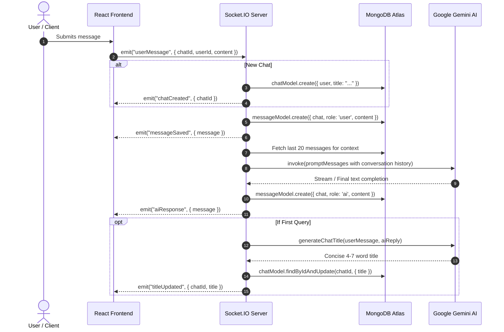
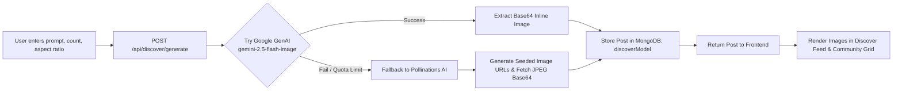
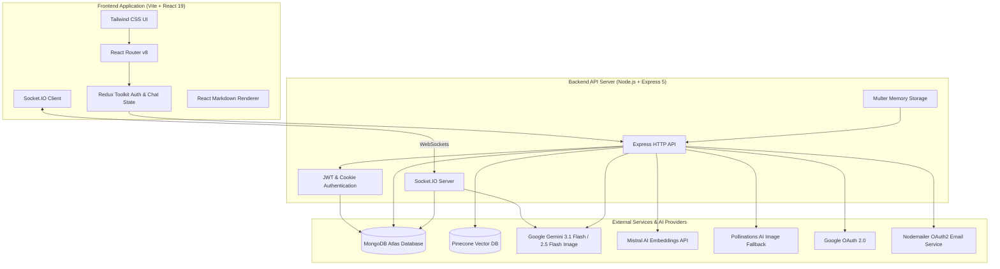

# 🧠 Perplexity AI Clone & Intelligent Knowledge Engine

[](https://react.dev/)
[](https://vitejs.dev/)
[](https://nodejs.org/)
[](https://www.mongodb.com/)
[](https://www.pinecone.io/)
[](https://ai.google.dev/)
[](https://mistral.ai/)
[](https://socket.io/)
[](https://tailwindcss.com/)

A modern, full-stack AI research and knowledge discovery platform inspired by **Perplexity AI**. The platform delivers real-time conversational search, document-grounded Retrieval-Augmented Generation (RAG) in dedicated knowledge spaces, generative image creation with community feed, thread collections, and multi-provider authentication.

---

## 📑 Table of Contents

- [Overview](#-overview)
- [Key Features](#-key-features)
- [How It Works & Core Workflows](#-how-it-works--core-workflows)
  - [1. Real-Time Conversational AI Workflow](#1-real-time-conversational-ai-workflow)
  - [2. Document Ingestion & RAG Pipeline](#2-document-ingestion--rag-pipeline)
  - [3. Image Generation & Discover Workflow](#3-image-generation--discover-workflow)
  - [4. High-Level System Architecture](#4-high-level-system-architecture)
- [Tools & Technologies Used](#-tools--technologies-used)
  - [Frontend Stack](#frontend-stack)
  - [Backend Stack](#backend-stack)
  - [AI & Vector Search](#ai--vector-search)
  - [Database & Storage](#database--storage)
- [Project Directory Structure](#-project-directory-structure)
- [API & Socket.IO Specifications](#-api--socketio-specifications)
  - [REST API Endpoints](#rest-api-endpoints)
  - [Socket.IO Events](#socketio-events)
- [Environment Configuration](#-environment-configuration)
- [Installation & Getting Started](#-installation--getting-started)
  - [Prerequisites](#prerequisites)
  - [1. Clone Repository](#1-clone-repository)
  - [2. Setup Backend](#2-setup-backend)
  - [3. Setup Frontend](#3-setup-frontend)
- [License](#-license)

---

## 🌟 Overview

This application combines deep information retrieval with interactive user experiences:
1. **Interactive Conversational Search**: Ask any question and receive clean, markdown-rendered responses with real-time bi-directional streaming over WebSockets.
2. **Knowledge Spaces (RAG)**: Create dedicated workspaces, upload your own documents (PDF, TXT, Markdown, CSV), and query your custom knowledge base with source citations.
3. **Discover & Multi-Engine Image Generation**: Generate stunning visuals using Google GenAI with automated fallback to Pollinations AI, complete with aspect-ratio selection and a community feed.
4. **Library & Collections**: Save and organize AI chat sessions into custom collections.
5. **Secure Authentication**: Register and log in via email/password (JWT in HTTP-only cookies) or Google OAuth 2.0, with email verification powered by Nodemailer.

---

## 🚀 Key Features

| Feature | Description |
|---|---|
| **Real-Time AI Chat** | Low-latency chat via Socket.IO powered by Google Gemini (`gemini-3.1-flash-lite`). Automatically retains chat history context for continuous conversation. |
| **Automatic Title Generation** | Asynchronously analyzes the user prompt and AI response to generate concise, 4-7 word chat titles. |
| **Knowledge Spaces (RAG)** | Spaces store documents in Pinecone serverless vector index with isolated namespaces for semantic search and grounded answers. |
| **Document Processing** | Extracts text from PDF files (`pdf-parse`) and plaintext/markdown formats, splitting content using LangChain RecursiveCharacterTextSplitter. |
| **1024-dim Mistral Embeddings** | Encodes text chunks and queries into dense vector representations using Mistral AI's `mistral-embed` model. |
| **Discover Feed & Image Studio** | Generate 1-4 images with aspect ratios (`1:1`, `16:9`, `9:16`) using Google GenAI or Pollinations AI fallback. Posts appear in a responsive discovery gallery. |
| **Thread Collections** | Group related chat threads into named collections for structured project management and reference. |
| **Robust Authentication** | Password hashing with `bcryptjs`, JWT cookies, Google OAuth 2.0 (`passport-google-oauth20`), and email verification. |

---

## 🔄 How It Works & Core Workflows

### 1. Real-Time Conversational AI Workflow

The chat interface allows users to submit queries and receive immediate responses. New conversations automatically generate thread titles.



---

### 2. Document Ingestion & RAG Pipeline

Knowledge Spaces enable Retrieval-Augmented Generation (RAG). Documents are parsed, chunked, embedded, and stored in Pinecone. When queries occur, top semantic chunks are injected into the LLM system prompt.

```mermaid
flowchart TD
    subgraph INGESTION["1. Document Ingestion & Vector Indexing"]
        A[User Uploads File: PDF / TXT / MD / CSV] --> B[Multer In-Memory Buffer]
        B --> C{File Type?}
        C -- PDF --> D[Extract text using pdf-parse]
        C -- TXT / MD / CSV --> E[Convert buffer to UTF-8 text]
        D --> F[LangChain RecursiveCharacterTextSplitter<br/>Chunk Size: 600, Overlap: 80]
        E --> F
        F --> G[Mistral AI Embeddings<br/>model: mistral-embed 1024-dim]
        G --> H[Upsert Vectors into Pinecone Index<br/>Namespace: spaceId, Batch Size: 100]
        H --> I[(Pinecone Serverless DB)]
        H --> J[(MongoDB: Space Metadata & Document Record)]
    end

    subgraph QUERY["2. RAG Query & Contextual Response"]
        K[User Query in Space Chat] --> L[Embed Query using Mistral AI]
        L --> M[Cosine Similarity Search on Pinecone<br/>Top-K: 5 in Namespace spaceId]
        M --> N[Retrieve Top Context Chunks & Metadata]
        N --> O[Construct System Prompt with Document Context & Sources]
        O --> P[Pass Augmented Context + History to Gemini]
        P --> Q[Generate Grounded Answer with Source Citations]
        Q --> R[Save User & AI Messages to MongoDB]
        R --> S[Return Markdown Response to Client]
    end
```



---

### 3. Image Generation & Discover Workflow

The Discover page allows users to create AI images with customizable counts and aspect ratios, backed by an automatic fallback mechanism.



---

### 4. High-Level System Architecture



---

## 🛠️ Tools & Technologies Used

### Frontend Stack

| Tool / Library | Version | Role / Purpose |
|---|---|---|
| **[React](https://react.dev/)** | `^19.1.1` | Modern component-based user interface library. |
| **[Vite](https://vitejs.dev/)** | `^7.1.7` | Blazing fast build tool and development server. |
| **[Redux Toolkit](https://redux-toolkit.js.org/)** | `^2.12.0` | Global state management for authentication, sessions, and active threads. |
| **[React Router](https://reactrouter.com/)** | `^8.2.0` | Declarative client-side routing, nested layouts, and route protection. |
| **[Tailwind CSS](https://tailwindcss.com/)** | `^4.3.2` | Utility-first CSS framework with modern color palette and responsive utilities. |
| **[Socket.IO Client](https://socket.io/docs/v4/client-api/)** | `^4.8.3` | Real-time bi-directional communication client for streaming chat. |
| **[React Markdown](https://github.com/remarkjs/react-markdown)** | `^10.1.0` | Renders rich AI responses (code blocks, markdown, lists, tables). |
| **[Axios](https://axios-http.com/)** | `^1.18.1` | Promise-based HTTP client with cookie credentials support. |

### Backend Stack

| Tool / Library | Version | Role / Purpose |
|---|---|---|
| **[Node.js](https://nodejs.org/)** | `^20+` | JavaScript runtime environment. |
| **[Express](https://expressjs.com/)** | `^5.2.1` | Web framework handling REST API endpoints, routing, and middlewares. |
| **[Socket.IO](https://socket.io/)** | `^4.8.3` | WebSockets server for real-time chat messages and title updates. |
| **[Mongoose](https://mongoosejs.com/)** | `^9.7.4` | Object Data Modeling (ODM) library for MongoDB data validation and relationships. |
| **[Multer](https://github.com/expressjs/multer)** | `^2.2.0` | Middleware for handling `multipart/form-data` document uploads in memory. |
| **[pdf-parse](https://www.npmjs.com/package/pdf-parse)** | `^2.4.5` | Extracts plaintext from PDF files for vectorization. |
| **[Passport.js](https://www.passportjs.org/)** | `^0.7.0` | Authentication middleware supporting Google OAuth 2.0 strategy. |
| **[JSON Web Token (JWT)](https://jwt.io/)** | `^9.0.3` | Generates secure access tokens stored in HTTP-only cookies. |
| **[bcryptjs](https://www.npmjs.com/package/bcryptjs)** | `^3.0.3` | Salts and hashes user passwords. |
| **[Nodemailer](https://nodemailer.com/)** | `^9.0.3` | Dispatches account verification emails via Google OAuth2 transport. |
| **[Morgan](https://github.com/expressjs/morgan)** | `^1.11.0` | HTTP request logger middleware. |
| **[CORS](https://github.com/expressjs/cors)** | `^2.8.6` | Cross-Origin Resource Sharing configuration with credential handling. |

### AI & Vector Search

| Tool / Service | Role / Purpose |
|---|---|
| **[Google Gemini](https://ai.google.dev/)** (`gemini-3.1-flash-lite`) | Primary language model for reasoning, search summaries, chat answers, and automated title synthesis. |
| **[Google GenAI](https://ai.google.dev/)** (`gemini-2.5-flash-image`) | Multimodal model for generative text-to-image creation. |
| **[Mistral AI](https://mistral.ai/)** (`mistral-embed`) | Produces 1024-dimensional dense semantic vector representations for document chunks and queries. |
| **[Pinecone](https://www.pinecone.io/)** | High-performance serverless vector database used to store embeddings segmented by space namespaces. |
| **[LangChain Core & Text Splitters](https://js.langchain.com/)** | Orchestrates character-aware text splitting (`RecursiveCharacterTextSplitter`) and model proxies. |
| **[Pollinations AI](https://pollinations.ai/)** | Resilient fallback image generation provider if primary Google image quotas or endpoints fail. |

### Database & Storage

| Database | Role / Purpose |
|---|---|
| **MongoDB Atlas** | Stores users, chats, messages, collections, space metadata, and discover posts. |
| **Pinecone Serverless** | Stores document chunk embeddings and metadata for vector similarity matching. |

---

## 📁 Project Directory Structure

```plaintext
Perplexity/
├── BACKEND/
│   ├── src/
│   │   ├── config/
│   │   │   ├── database.js               # MongoDB connection setup
│   │   │   ├── socket.js                 # Socket.IO chat handler & title generator
│   │   │   └── services/
│   │   │       ├── ai.sevice.js          # Google Gemini model proxy & LangChain config
│   │   │       ├── imagen.service.js     # Image generation (Gemini + Pollinations AI fallback)
│   │   │       ├── mail.service.js       # Nodemailer OAuth2 email service
│   │   │       └── rag.service.js        # Text extraction, chunking, Mistral embeddings, Pinecone
│   │   ├── controllers/
│   │   │   ├── auth.controller.js        # Register, login, profile, email verification
│   │   │   ├── chat.controller.js        # Threads CRUD & message history
│   │   │   └── rag.controller.js         # Space CRUD, document indexing, space chat
│   │   ├── middlewares/
│   │   │   ├── auth.middleware.js        # JWT cookie verification middleware
│   │   │   └── validation.middleware.js  # express-validator request rules
│   │   ├── models/
│   │   │   ├── chat.model.js             # Chat thread schema
│   │   │   ├── collection.model.js       # Custom collection schema
│   │   │   ├── discover.model.js         # AI generated post schema
│   │   │   ├── message.model.js          # User & AI message schema
│   │   │   ├── space.model.js            # Knowledge space & documents schema
│   │   │   └── user.model.js             # User account schema
│   │   ├── routes/
│   │   │   ├── auth.router.js            # Auth routes (/api/auth)
│   │   │   ├── chat.router.js            # Chat thread routes (/api/chat)
│   │   │   ├── collection.router.js      # Collection routes (/api/collections)
│   │   │   ├── discover.router.js        # Discover feed & generation (/api/discover)
│   │   │   └── rag.router.js             # Space & RAG routes (/api/spaces)
│   │   └── app.js                        # Express app configuration & middleware
│   ├── .env                              # Environment variables (Backend)
│   ├── package.json                      # Backend dependencies & scripts
│   └── server.js                         # Application entry point & server listener
│
└── Frontend/
    ├── public/                           # Static assets
    ├── src/
    │   ├── app/
    │   │   ├── App.jsx                   # Main layout component
    │   │   ├── app.routes.jsx            # React Router route definitions
    │   │   ├── app.store.js              # Redux store configuration
    │   │   └── index.css                 # Global styling & Tailwind directives
    │   ├── features/
    │   │   ├── auth/                     # Authentication components, pages & hooks
    │   │   │   ├── components/           # Protected route wrappers & forms
    │   │   │   ├── pages/                # Home, Login, Register
    │   │   │   └── service/              # Auth API calls
    │   │   ├── auth.slice.js             # Redux auth slice
    │   │   └── chat/                     # Chat components, state & context
    │   ├── pages/
    │   │   ├── Chat.jsx                  # Main real-time AI search interface
    │   │   ├── Discover.jsx              # Image generation studio & public feed
    │   │   ├── Library.jsx               # Spaces, Collections & History browser
    │   │   └── SpaceChat.jsx             # Grounded RAG chat for specific spaces
    │   └── main.jsx                      # React 19 application root entry
    ├── .env                              # Environment variables (Frontend)
    ├── package.json                      # Frontend dependencies & scripts
    └── vite.config.js                    # Vite configuration
```

---

## 📡 API & Socket.IO Specifications

### REST API Endpoints

#### Authentication (`/api/auth`)
| Method | Endpoint | Description | Auth Required |
|---|---|---|---|
| `POST` | `/api/auth/register` | Register new user account | No |
| `POST` | `/api/auth/login` | Authenticate with email/password and set JWT cookie | No |
| `GET` | `/api/auth/verify-email` | Verify email token sent via email | No |
| `GET` | `/api/auth/get-me` | Retrieve current authenticated user profile | Yes |
| `GET` | `/auth/google` | Trigger Google OAuth 2.0 flow | No |
| `GET` | `/auth/google/callback` | Google OAuth callback handler | No |

#### Chat & Threads (`/api/chat`)
| Method | Endpoint | Description | Auth Required |
|---|---|---|---|
| `GET` | `/api/chat/threads` | Get all chat threads for the authenticated user | Yes |
| `GET` | `/api/chat/threads/:chatId` | Get all messages belonging to a chat thread | Yes |
| `PATCH` | `/api/chat/threads/:chatId` | Rename a chat thread title | Yes |
| `DELETE` | `/api/chat/threads/:chatId` | Delete a chat thread and all its messages | Yes |

#### Knowledge Spaces & RAG (`/api/spaces`)
| Method | Endpoint | Description | Auth Required |
|---|---|---|---|
| `GET` | `/api/spaces` | List all user Knowledge Spaces | Yes |
| `POST` | `/api/spaces` | Create a new Knowledge Space | Yes |
| `GET` | `/api/spaces/:id` | Fetch specific space details & document metadata | Yes |
| `PUT` | `/api/spaces/:id` | Update space name or description | Yes |
| `DELETE` | `/api/spaces/:id` | Delete space and remove vectors from Pinecone | Yes |
| `POST` | `/api/spaces/:id/upload` | Upload document (`PDF`, `TXT`, `MD`, `CSV`), chunk, embed, and index | Yes |
| `DELETE` | `/api/spaces/:id/documents/:docId` | Delete document and its vectors from Pinecone | Yes |
| `POST` | `/api/spaces/:id/chat` | RAG query against documents in the space | Yes |
| `GET` | `/api/spaces/:id/chat/:chatId/messages`| Get message history for a space chat | Yes |

#### Collections (`/api/collections`)
| Method | Endpoint | Description | Auth Required |
|---|---|---|---|
| `GET` | `/api/collections` | List user collections with populated threads | Yes |
| `POST` | `/api/collections` | Create a new collection | Yes |
| `PUT` | `/api/collections/:id` | Rename / update a collection | Yes |
| `DELETE` | `/api/collections/:id` | Delete a collection | Yes |
| `POST` | `/api/collections/:id/threads` | Add or remove a thread from a collection (`action: 'add' \| 'remove'`) | Yes |

#### Discover Feed (`/api/discover`)
| Method | Endpoint | Description | Auth Required |
|---|---|---|---|
| `GET` | `/api/discover` | Get recent community image generation feed (limit 30) | Yes |
| `POST` | `/api/discover/generate` | Generate AI images from prompt with aspect ratio | Yes |

---

### Socket.IO Events

| Event Name | Direction | Payload | Description |
|---|---|---|---|
| `joinChat` | Client -> Server | `{ chatId }` | Joins a chat room socket channel |
| `userMessage` | Client -> Server | `{ chatId, userId, content }` | Submits a user prompt to the AI agent |
| `chatCreated` | Server -> Client | `{ chatId }` | Emitted when a new thread is created from a prompt |
| `messageSaved`| Server -> Client | `{ chatId, message }` | Confirms user message was saved in MongoDB |
| `aiResponse` | Server -> Client | `{ chatId, message }` | Delivers the generated response from Gemini |
| `titleUpdated`| Server -> Client | `{ chatId, title }` | Broadcasts the AI-synthesized thread title |
| `error` | Server -> Client | `{ message }` | Emitted on server/processing errors |

---

## ⚙️ Environment Configuration

### Backend Configuration (`BACKEND/.env`)

Create a `.env` file in the `BACKEND` directory:

```env
# Server Port
PORT=3000

# MongoDB Connection String
MONGODB_URI=mongodb+srv://<username>:<password>@cluster.mongodb.net/perplexity

# Frontend URL (for CORS validation)
FRONTEND_URL=http://localhost:5173

# JWT Secret for Session Cookies
JWT_SECRET=your_jwt_secret_key_here

# Google Gemini API Key (Chat & Title Generation)
GEMINI_API_KEY=your_gemini_api_key_here

# Mistral AI API Key (Embeddings for RAG)
MISTRAL_API_KEY=your_mistral_api_key_here

# Pinecone Vector Database Configuration
PINECONE_API_KEY=your_pinecone_api_key_here
PINECONE_INDEX_NAME=perplexityrag

# Google OAuth 2.0 Credentials (Optional: for Google Login & Nodemailer)
GOOGLE_USER=your_email@gmail.com
GOOGLE_CLIENT_ID=your_google_client_id.apps.googleusercontent.com
GOOGLE_CLIENT_SECRET=your_google_client_secret
GOOGLE_REFRESH_TOKEN=your_google_refresh_token
```

### Frontend Configuration (`Frontend/.env`)

Create a `.env` file in the `Frontend` directory:

```env
# Backend Base API URL
VITE_API_BASE_URL=http://localhost:3000
```

---

## 📦 Installation & Getting Started

### Prerequisites

Ensure you have installed:
- **Node.js** (v18.x or v20.x recommended)
- **npm** (v9+ or compatible package manager)
- **MongoDB** instance (local or MongoDB Atlas)
- **Pinecone** account & API key
- **Google Gemini** API key
- **Mistral AI** API key

---

### 1. Clone Repository

```bash
git clone https://github.com/MayankRai89/Perplexity.git
cd Perplexity
```

---

### 2. Setup Backend

1. Navigate to the backend folder:
   ```bash
   cd BACKEND
   ```

2. Install backend dependencies:
   ```bash
   npm install
   ```

3. Configure environment variables in `BACKEND/.env` (refer to [Backend Configuration](#backend-configuration-backendenv)).

4. Start the backend development server:
   ```bash
   npm run dev
   ```
   *The server starts on `http://localhost:3000` and validates AI model connectivity.*

---

### 3. Setup Frontend

1. Open a new terminal and navigate to the frontend folder:
   ```bash
   cd Frontend
   ```

2. Install frontend dependencies:
   ```bash
   npm install
   ```

3. Configure environment variables in `Frontend/.env` (refer to [Frontend Configuration](#frontend-configuration-frontendenv)).

4. Start the Vite development server:
   ```bash
   npm run dev
   ```
   *The client will be running at `http://localhost:5173`.*

---

## 🧪 Testing Features

1. **Sign Up & Sign In**: Navigate to `http://localhost:5173/register` and create an account.
2. **Main Search / Chat**: Head to `/chat`, submit any question, and witness real-time AI responses and automatic title synthesis.
3. **Knowledge Spaces (RAG)**:
   - Navigate to `/library` -> **Spaces**.
   - Create a new space (e.g., "Research Papers").
   - Upload a PDF or text file. Watch chunks get extracted, embedded via Mistral, and indexed in Pinecone.
   - Click into the Space Chat to ask specific questions answered directly from your uploaded documents.
4. **Collections**:
   - In `/library`, create a collection (e.g., "AI Engineering").
   - Add chat threads into the collection to keep conversations categorized.
5. **Discover**:
   - Go to `/discover`.
   - Type an image prompt (e.g., *"Futuristic Cyberpunk Library in Neo Tokyo"*), pick an aspect ratio (`16:9`), and click generate.
   - View your newly rendered artwork in the community gallery.

---

## 📄 License

This project is open-source and available under the [ISC License](LICENSE).
